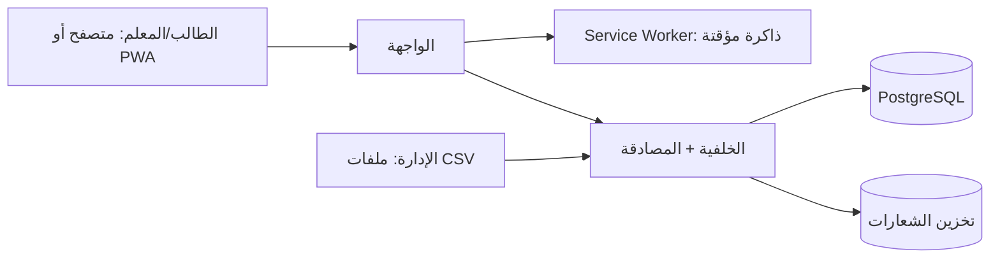

# مواصفات متطلبات البرمجيات (SRS)
## تطبيق «دفتري» لمتابعة الطالب — الإصدار الأول (MVP)

| البند | القيمة |
|---|---|
| الإصدار | 2.0 |
| التاريخ | 11 نوفمبر 2026 |
| المرجع | `01-BRD.md` |
| التصميم | `03-Design-System.md` |

**الأولويات:** M = إلزامي، S = مستحسن، C = اختياري. **[افتراض]** = قرار وضعته لعدم وجود إجابة.

---

## 1. المقدمة

### 1.1 الغرض
تحديد المتطلبات الوظيفية وغير الوظيفية لتطبيق ويب (PWA) يعرض للطالب: جدول الدروس مع المعلمين، رسائل المعلمين بما هو مطلوب، والواجبات المنجزة والمتبقية.

### 1.2 النطاق
مدرسة واحدة (~2000 طالب، ~200 معلم). ثلاث ميزات للطالب، وأدوات حد أدنى للمعلم والإدارة لتغذية المحتوى.

### 1.3 التعريفات
| المصطلح | المعنى |
|---|---|
| الحصة (Period) | فترة دراسية في اليوم (الأولى، الثانية...) |
| الشعبة | مجموعة طلاب في صف |
| المطلوب (Action) | نص يحدد ما يجب على الطالب فعله في رسالة المعلم |
| الأسبوع الدراسي | من الأحد إلى الخميس **[افتراض]** |

## 2. الوصف العام

### 2.1 المستخدمون والصلاحيات
| الدور | الوصف | الصلاحيات |
|---|---|---|
| الطالب | المستخدم الأساسي | قراءة جدوله ورسائله وواجباته، وسم الواجب "أنجزت" |
| المعلم | يغذّي المحتوى | نشر واجبات ورسائل لشعبه فقط، تأكيد إنجاز الواجبات |
| إدارة المدرسة | الإعداد | استيراد البيانات، إدارة الحسابات، إعادة تعيين كلمات المرور، تعديل الجدول |
| Super Admin | مالك النظام | كل ما سبق وإعدادات المدرسة وسجل التدقيق |

| الإمكانية | طالب | معلم | إدارة | SA |
|---|:-:|:-:|:-:|:-:|
| عرض الجدول (الخاص به) | ✔ | ✔ (جدوله) | ✔ (الكل) | ✔ |
| قراءة الرسائل | ✔ (رسائله) | ✔ (المرسلة) | ✔ | ✔ |
| إرسال رسالة | ✖ | ✔ (طلاب شعبه) | ✔ | ✔ |
| نشر واجب | ✖ | ✔ (شعبه) | ✖ | ✔ |
| وسم "أنجزت" | ✔ | ✖ | ✖ | ✖ |
| تأكيد الإنجاز | ✖ | ✔ | ✖ | ✔ |
| الاستيراد وإدارة الحسابات | ✖ | ✖ | ✔ | ✔ |

### 2.2 بيئة التشغيل
المتصفحات الحديثة (Chrome، Safari، Edge، Firefox) بآخر نسختين، والتركيز على الهاتف (360px وأكبر)، مع إمكانية التثبيت كتطبيق (PWA).

### 2.3 القيود
بلا ميزانية (خدمات مجانية)، بلا تطبيق متاجر، بلا Google Login، بلا دفع، بلا ردود من الطالب على الرسائل.

### 2.4 الافتراضات
ملف عينة K12 متوفر؛ المدرسة تصدر بيانات الدخول؛ الاتصال بالإنترنت متقطع أحياناً.

## 3. المتطلبات الوظيفية

### 3.1 المصادقة (AUTH)
| ID | المتطلب | أ |
|---|---|:-:|
| AUTH-01 | تسجيل الدخول باسم المستخدم وكلمة المرور الصادرين من المدرسة | M |
| AUTH-02 | لا يوجد تسجيل ذاتي أو استعادة بالبريد للطلاب؛ إعادة التعيين من المعلم/الإدارة | M |
| AUTH-03 | طلب تغيير كلمة المرور عند أول دخول | S |
| AUTH-04 | حد لمحاولات الدخول الفاشلة (قفل مؤقت) وسياسة كلمة مرور معقولة للمعلمين والإدارة | M |
| AUTH-05 | جلسة آمنة تنتهي بعد خمول طويل، وخيار "تذكرني" على الجهاز الشخصي | S |
| AUTH-06 | رسالة خطأ واضحة غير كاشفة (لا تحدد أي الحقلين خاطئ) | M |

### 3.2 الشاشة الرئيسية (HOME)
| ID | المتطلب | أ |
|---|---|:-:|
| HOME-01 | عرض اسم الطالب، الهوية، الصف والشعبة، اسم المدرسة وشعارها | M |
| HOME-02 | ثلاثة مداخل فقط: الجدول، الرسائل، الواجبات، لكل منها **سطر حالة حي** (الحصة القادمة / عدد الرسائل الجديدة / عدد الواجبات المتبقية) | M |
| HOME-03 | الشاشة تعمل بدون إنترنت بآخر بيانات محفوظة مع وسم "آخر تحديث" | S |
| HOME-04 | تبديل اللغة (عربي/إنجليزي) | C |
| HOME-05 | زر تسجيل الخروج | M |

### 3.3 جدول الدروس (TT)
| ID | المتطلب | أ |
|---|---|:-:|
| TT-01 | عرض الجدول الأسبوعي: الأيام × الحصص، وفي كل خلية **المادة واسم المعلم** | M |
| TT-02 | على الهاتف: عرض يوم واحد بتبويبات الأيام، مع تمييز اليوم الحالي والحصة الجارية | M |
| TT-03 | عرض أوقات بداية ونهاية الحصة | M |
| TT-04 | قائمة "معلمو موادي": المادة ← اسم المعلم (مرجع سريع) | S |
| TT-05 | رقم القاعة إن توفر | C |
| TT-06 | الجدول متاح دون إنترنت بعد أول تحميل | S |
| TT-07 | تعطيل/تعديل حصة بشكل استثنائي (غياب معلم) من الإدارة | C |

### 3.4 صندوق الرسائل (MSG)
| ID | المتطلب | أ |
|---|---|:-:|
| MSG-01 | قائمة الرسائل مرتبة بالأحدث، وكل عنصر يبيّن: اسم المعلم والمادة، العنوان، وقت الإرسال، حالة القراءة | M |
| MSG-02 | تفاصيل الرسالة: النص، و**كتلة "المطلوب"** مميزة بصرياً (ما المطلوب، وموعد التنفيذ إن وجد) | M |
| MSG-03 | وسم الرسالة مقروءة تلقائياً عند فتحها، وشارة عدد غير المقروء على الأيقونة | M |
| MSG-04 | فلترة حسب المعلم/المادة | S |
| MSG-05 | ربط الرسالة بواجب (إن كانت بخصوص واجب) مع انتقال مباشر له | S |
| MSG-06 | الطالب للقراءة فقط (لا ردود في MVP) **[افتراض]** | M |
| MSG-07 | المعلم يرسل لشعبة كاملة أو لطالب محدد، ويرى عدد من قرأ | M |
| MSG-08 | الأرشفة التلقائية لرسائل قديمة (أقدم من 90 يوماً) مع البحث فيها | C |

### 3.5 الواجبات (ASG)
| ID | المتطلب | أ |
|---|---|:-:|
| ASG-01 | قسم **"المتبقي"**: واجبات لم تُنجز، مرتبة بموعد التسليم، مع تمييز المتأخر والذي يحل اليوم | M |
| ASG-02 | قسم **"أنجزته"**: الواجبات المنجزة مجمّعة **بالأسبوع** (الأسبوع الحالي، الماضي، ثم تواريخ أقدم) مع عدّاد "أنجزت X من Y" لكل أسبوع | M |
| ASG-03 | **صف الإنجاز (Stitch Row):** تمثيل بصري لكل أسبوع بعلامة لكل واجب (منجز/متبقٍ/متأخر) | M |
| ASG-04 | الطالب يضغط "أنجزت" فينتقل الواجب لسجل الأسبوع، مع إمكانية التراجع لمدة قصيرة | M |
| ASG-05 | تفاصيل الواجب: المادة، المعلم، الوصف، موعد التسليم | M |
| ASG-06 | المعلم ينشر واجباً (مادة، شعبة، عنوان، وصف، موعد) في أقل من دقيقة | M |
| ASG-07 | المعلم يرى قائمة طلاب الشعبة وحالة كل واحد (منجز/لم ينجز) | M |
| ASG-08 | تأكيد المعلم للإنجاز (علامة ثانية "مؤكد") **[افتراض]** | S |
| ASG-09 | تعديل/إلغاء واجب منشور مع إشعار للطلاب | S |
| ASG-10 | رفع صورة/ملف كإثبات للحل | C (مؤجل) |

### 3.5.1 قواعد الواجبات
- BRL-01: الأسبوع يبدأ يوم الأحد.
- BRL-02: الواجب المتأخر = موعده مضى ولم يُوسم منجزاً؛ يبقى ظاهراً في "المتبقي" حتى يُنجز.
- BRL-03: لا يُحذف واجب له سجلات إنجاز؛ يُؤرشف.
- BRL-04: الطالب يرى واجبات شعبته فقط.

### 3.6 الإشعارات (NOT)
| ID | المتطلب | أ |
|---|---|:-:|
| NOT-01 | شارات داخل التطبيق على الأيقونات (رسائل جديدة، واجبات جديدة) | M |
| NOT-02 | إشعارات Push على الهاتف (PWA) عند رسالة أو واجب جديد، إن دعمها الجهاز | C |
| NOT-03 | لا بريد إلكتروني للطلاب في MVP | — |

### 3.7 أدوات الإدارة (ADM)
| ID | المتطلب | أ |
|---|---|:-:|
| ADM-01 | استيراد CSV/XLSX: الطلاب، المعلمون، الصفوف والشعب، المواد، إسناد المعلمين، الجدول | M |
| ADM-02 | معالج تعيين أعمدة ومعاينة وتقرير أخطاء قبل الاعتماد | M |
| ADM-03 | تحديث السجلات الموجودة بدل تكرارها (مفتاح: الرقم المدرسي / رقم المعلم) | M |
| ADM-04 | توليد أسماء مستخدمين وكلمات مرور مؤقتة وتصدير ورقة طباعة لكل صف | M |
| ADM-05 | إعادة تعيين كلمة مرور طالب/معلم | M |
| ADM-06 | تعطيل/أرشفة حساب دون حذف السجلات | M |
| ADM-07 | إعداد المدرسة: الاسم، الشعار، أيام الدوام، أوقات الحصص | M |
| ADM-08 | سجل تدقيق لعمليات الإدارة الحساسة | S |

### 3.8 الواجهة واللغة (UI)
| ID | المتطلب | أ |
|---|---|:-:|
| UI-01 | عربي RTL كأساس، وتطبيق نظام التصميم في `03-Design-System.md` | M |
| UI-02 | هاتف أولاً وأهداف لمس ≥ 44px | M |
| UI-03 | وضع داكن (دفتر الليل) | S |
| UI-04 | حالات فارغة وأخطاء بنصوص مفهومة ومحددة | M |
| UI-05 | إنجليزي LTR كخيار ثانٍ | C |

## 4. حالات الاستخدام

**UC-01: دخول الطالب ومعرفة يومه**
الطالب يدخل بالاسم وكلمة المرور ← تظهر الشاشة الرئيسية بهويته ← يقرأ سطر الحالة (حصتك القادمة، رسائل جديدة، واجبات متبقية) ← يفتح القسم المطلوب.

**UC-02: معرفة معلم كل مادة**
الطالب يفتح الجدول ← يرى المادة واسم المعلم في كل خلية ← يضغط على الحصة لرؤية تفاصيلها.

**UC-03: قراءة المطلوب من معلم**
الطالب يفتح الرسائل ← يختار رسالة ← يقرأ كتلة "المطلوب" ← (اختياري) ينتقل للواجب المرتبط.

**UC-04: متابعة الواجبات**
الطالب يفتح الواجبات ← يرى المتبقي أولاً ← ينجز واحداً ويضغط "أنجزت" ← يرى الصف الأسبوعي يمتلئ.

**UC-05: نشر المعلم لواجب**
المعلم يفتح "واجب جديد" ← يختار المادة والشعبة والموعد ← ينشر ← تظهر الشارة لدى الطلاب.

**UC-06: استيراد بيانات K12**
الإدارة ترفع الملف ← تعيّن الأعمدة ← تعاين الأخطاء ← تعتمد ← تُنشأ الحسابات وتُصدَّر أوراق الدخول.

## 5. المتطلبات غير الوظيفية

### 5.1 الأداء والسعة
| ID | المتطلب |
|---|---|
| NFR-P1 | دعم 2,000 طالب و200 معلم، وذروة 800 مستخدم متزامن (صباح الدوام) **[افتراض]** |
| NFR-P2 | تحميل الشاشة الرئيسية ≤ 2 ثانية على 4G (p95) |
| NFR-P3 | وزن الصفحة الأولى ≤ 300KB مضغوطاً؛ الخطوط بنمط font-display: swap وبتجزئة الحروف |
| NFR-P4 | استجابة API ≤ 400ms (p95) للعمليات الشائعة |

### 5.2 التوفر
| ID | المتطلب |
|---|---|
| NFR-A1 | توفر ≥ 99% خلال ساعات الدوام (7:00–17:00 أحد–خميس) |
| NFR-A2 | نسخ احتياطي يومي، واختبار استعادة مرة كل فصل |
| NFR-A3 | تحمل انقطاع الإنترنت: الجدول والرسائل المحمّلة والواجبات تُقرأ دون اتصال (قراءة فقط) |

### 5.3 الأمان
| ID | المتطلب |
|---|---|
| NFR-S1 | HTTPS دائماً، وتشفير البيانات المخزنة |
| NFR-S2 | كلمات المرور مجزّأة بـ Argon2id أو bcrypt، ولا تُخزن نصاً |
| NFR-S3 | فحص الصلاحيات على الخادم لكل طلب (الطالب يرى بياناته فقط؛ المعلم شعبه فقط) |
| NFR-S4 | حماية من OWASP Top 10: XSS، CSRF، حقن SQL، IDOR |
| NFR-S5 | Rate Limiting على الدخول والاستيراد |
| NFR-S6 | لا ظهور لبيانات طالب لطالب آخر، ولا مراسلات بين الطلاب |

### 5.4 الخصوصية (بيانات قاصرين)
| ID | المتطلب |
|---|---|
| NFR-D1 | جمع أقل قدر من البيانات: الاسم، الرقم المدرسي، الصف، الشعبة، اسم المستخدم |
| NFR-D2 | لا إعلانات ولا أدوات تتبع طرف ثالث |
| NFR-D3 | سياسة خصوصية مبسّطة بالعربية تُعرض عند أول دخول |
| NFR-D4 | سياسة احتفاظ: أرشفة/حذف بيانات الطلاب المغادرين بعد فترة تحددها المدرسة |
| NFR-D5 | مراجعة موقع الاستضافة والاشتراطات القانونية قبل الإطلاق الفعلي |

### 5.5 قابلية الاستخدام وإمكانية الوصول
| ID | المتطلب |
|---|---|
| NFR-U1 | إنجاز كل مهمة رئيسية للطالب بـ ≤ 3 نقرات من الشاشة الرئيسية |
| NFR-U2 | WCAG 2.1 AA: تباين، تركيز مرئي، تسميات للقارئات الصوتية، احترام `prefers-reduced-motion` |
| NFR-U3 | لا اعتماد على اللون وحده لنقل الحالة (منجز/متبقٍ/متأخر يحمل شكلاً ونصاً) |

### 5.6 الصيانة
| ID | المتطلب |
|---|---|
| NFR-M1 | بيئتان: تجريبية وإنتاج؛ نشر آلي عند الدمج |
| NFR-M2 | تغطية اختبارات آلية ≥ 60% للمنطق (الصلاحيات، الأسابيع، الاستيراد) |
| NFR-M3 | تتبع أخطاء ومراقبة بخدمة مجانية |

## 6. المعمارية المقترحة (ميزانية صفر) **[افتراض]**

| الطبقة | الاقتراح | السبب |
|---|---|---|
| الواجهة | Next.js أو SvelteKit (TypeScript) كـ PWA | RTL وPWA وأداء |
| الخلفية وقاعدة البيانات | خدمة مُدارة بطبقة مجانية (PostgreSQL مع مصادقة وتخزين) | تقليل العمل والتكلفة |
| الاستضافة | منصة استضافة واجهات بطبقة مجانية | نشر آلي وشبكة توزيع |
| التخزين المؤقت | Service Worker | العمل دون اتصال |
| التتبع | خدمة تتبع أخطاء بطبقة مجانية | رؤية مبكرة |

> **تنبيه:** حدود الطبقات المجانية (حجم القاعدة، إيقاف المشروع عند الخمول، عدد المستخدمين) تتغير. يجب التحقق منها وقت التنفيذ، وإجراء اختبار حمل على 800 مستخدم متزامن قبل التجربة، وتجهيز خطة بديلة بتكلفة منخفضة إذا لم تكفِ.

**النمط:** تطبيق واحد منظم بوحدات (auth، org، timetable، messages، assignments، import)، وتصميم يحمل `school_id` في الجداول لتسهيل التوسع لمدارس متعددة لاحقاً.



## 7. نموذج البيانات (مبدئي)

```mermaid
erDiagram
  SCHOOL ||--o{ USER : has
  USER ||--o| STUDENT_PROFILE : is
  USER ||--o| TEACHER_PROFILE : is
  GRADE_LEVEL ||--o{ SECTION : contains
  SECTION ||--o{ STUDENT_PROFILE : enrolls
  SUBJECT ||--o{ TEACHING_ASSIGNMENT : taught
  TEACHER_PROFILE ||--o{ TEACHING_ASSIGNMENT : teaches
  SECTION ||--o{ TEACHING_ASSIGNMENT : for
  TEACHING_ASSIGNMENT ||--o{ TIMETABLE_SLOT : scheduled
  TEACHING_ASSIGNMENT ||--o{ ASSIGNMENT : sets
  ASSIGNMENT ||--o{ ASSIGNMENT_STATUS : tracked
  STUDENT_PROFILE ||--o{ ASSIGNMENT_STATUS : has
  TEACHER_PROFILE ||--o{ MESSAGE : sends
  MESSAGE ||--o{ MESSAGE_RECIPIENT : to
  STUDENT_PROFILE ||--o{ MESSAGE_RECIPIENT : receives
  USER ||--o{ AUDIT_LOG : acts
```

**الحقول المهمة:**
- `timetable_slot`: يوم، رقم الحصة، وقت البداية، وقت النهاية، القاعة (اختياري).
- `message`: عنوان، نص، **required_action** (نص المطلوب)، **due_at** (اختياري)، **assignment_id** (اختياري).
- `message_recipient`: `read_at`.
- `assignment`: عنوان، وصف، `due_at`، `published_at`، `archived_at`.
- `assignment_status`: `done_at`، `confirmed_by_teacher_at`.

## 8. الواجهات
- **شاشات الطالب:** الدخول، الرئيسية، الجدول (يوم/أسبوع)، قائمة الرسائل، تفاصيل رسالة، الواجبات (متبقٍ/أنجزته)، تفاصيل واجب.
- **شاشات المعلم:** واجب جديد، رسالة جديدة، متابعة الشعبة.
- **شاشات الإدارة:** الاستيراد، المستخدمون وكلمات المرور، إعدادات المدرسة.
- **تكاملات خارجية:** لا شيء في MVP.

**نقاط API (أمثلة)**
```
POST /auth/login                 GET  /me
GET  /me/timetable               GET  /me/messages        PATCH /messages/:id/read
GET  /me/assignments?status=     PATCH /assignments/:id/done
POST /assignments                POST /messages
POST /imports                    GET  /imports/:id/report
```

## 9. معايير القبول

| # | المعيار |
|---|---|
| AC-1 | طالب يسجل الدخول ويرى اسمه وهويته وصفه واسم المدرسة وشعارها وثلاثة مداخل فقط |
| AC-2 | الجدول يعرض اسم المعلم الصحيح لكل مادة لشعبة الطالب |
| AC-3 | معلم يرسل رسالة بحقل "المطلوب" ← تظهر للطالب مع شارة، وتختفي الشارة بعد القراءة |
| AC-4 | معلم ينشر واجباً ← يظهر في "المتبقي" لطلاب الشعبة فقط |
| AC-5 | الطالب يضغط "أنجزت" ← ينتقل الواجب لأسبوعه ويتحدث الصف والعدّاد |
| AC-6 | سجل الأسابيع الماضية يعرض "أنجزت X من Y" بدقة |
| AC-7 | لا يستطيع طالب الوصول لبيانات طالب آخر عبر تعديل معرّفات (اختبار IDOR) |
| AC-8 | استيراد عينة K12 (≥ 2000 طالب) بدون تكرارات مع تقرير أخطاء واضح |
| AC-9 | الجدول والرسائل المحمّلة تُقرأ دون إنترنت |
| AC-10 | الشاشة الرئيسية ≤ 2 ثانية على 4G، واختبار حمل 800 مستخدم متزامن ناجح |
| AC-11 | تباين الألوان والتركيز والتسميات تحقق WCAG AA في الشاشات الرئيسية |

## 10. مصفوفة التتبع

| متطلب تجاري | متطلبات وظيفية | قبول |
|---|---|---|
| BR-01 | AUTH-01..06 | AC-1، AC-7 |
| BR-02 | HOME-01..05 | AC-1 |
| BR-03 | TT-01..06 | AC-2، AC-9 |
| BR-04 | MSG-01..07 | AC-3 |
| BR-05 | ASG-01..08 | AC-4، AC-5، AC-6 |
| BR-06 | ADM-01..04 | AC-8 |
| BR-07 | ASG-06..07، MSG-07 | AC-3، AC-4 |
| BR-08 | UI-01..05 | AC-11 |
| BR-10 | NFR-S، NFR-D | AC-7 |

## 11. نقاط مفتوحة
1. الهوية المعروضة: رقم مدرسي أم هوية مخفية جزئياً؟
2. هل يحتاج الطالب رفع إثبات للواجب أم يكفي "أنجزت"؟
3. هل تُسمح الردود من الطالب على الرسائل في مرحلة لاحقة؟
4. هل الإشعارات الخارجية (Push) مطلوبة في الإصدار الأول؟
5. أوقات الحصص وأيام الدوام الفعلية للمدرسة.
